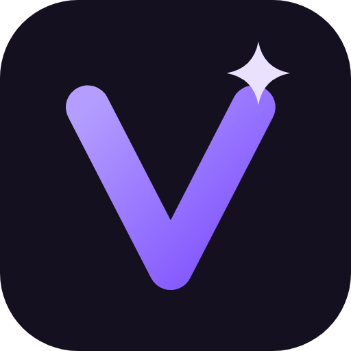

<div align="center">



# Vegas

### Reproductor de música personal para Android y Windows

[](LICENSE)

</div>

> [!IMPORTANT]
> Vegas es un **proyecto personal**, hecho para uso propio y compartido tal cual. No hay versiones publicadas, ni soporte, ni compromiso de mantenimiento. Es una **versión modificada de [Metrolist](https://github.com/MetrolistGroup/Metrolist)** y no está afiliada a Metrolist, YouTube ni Google.

## Qué es

Vegas es un cliente de YouTube Music escrito en Kotlin con Material 3. Parte de Metrolist y cambia el enfoque hacia un uso personal y sencillo:

- **Sin cuenta por defecto.** Biblioteca, listas y «Me gusta» se guardan en el dispositivo. La cuenta de Google es opcional y solo sirve para reproducir canciones con restricción de edad; no se sincroniza nada con ella.
- **App de escritorio para Windows** (módulo `desktop`, Compose Multiplatform) con su propio reproductor (FFmpeg), descargas y modo sin conexión.
- **Sincronización móvil ↔ PC en la red de casa** (módulo `synccore`): emparejamiento, HTTPS en la LAN y descubrimiento por mDNS, sin servidores externos.
- **Descargas y modo sin conexión**, listas propias y mejoras de reproducción (recuperación de cortes, elección de cliente de streaming).
- **API local de control** en el PC (puerto 47322, con token) para manejar la reproducción desde otras apps de casa.
- Nombre, icono y textos propios: la marca Metrolist solo aparece en los créditos.

## Estructura

| Módulo | Qué contiene |
|---|---|
| `app` | App de Android. El flavor por defecto es `personal` (sin servicios de Google ni actualizador). |
| `desktop` | App de Windows (Kotlin/JVM + Compose Multiplatform), instalador MSI. |
| `synccore` | Protocolo de sincronización compartido entre móvil y PC. |
| `innertube` | Acceso a YouTube Music (heredado de Metrolist). |
| `docs/vegas` | Documentación de Vegas: escritorio, control, licencias, sincronización con Metrolist. |
| `docs/superpowers/specs` | Diseño de cada funcionalidad. |

## Compilar

Requisitos: JDK 21 y Android SDK (para la app de Android).

```bash
# Android (flavor personal, depuración)
./gradlew :app:assemblePersonalDebug

# Windows
./gradlew :desktop:run          # abrir sin instalar
./gradlew :desktop:packageMsi   # instalador en desktop/build/compose/binaries/main/msi/

# Tests
./gradlew :synccore:test :desktop:test :app:testPersonalDebugUnitTest
```

Claves opcionales (Last.fm) se leen de `local.properties` o de variables de entorno (`LASTFM_API_KEY`, `LASTFM_SECRET`); sin ellas la app funciona igual. Más detalles del escritorio en [docs/vegas/escritorio.md](docs/vegas/escritorio.md).

## Aviso legal

- Vegas **no está afiliada, patrocinada ni respaldada** por YouTube, Google LLC, Metrolist Group LLC ni ninguna de sus filiales. Todas las marcas pertenecen a sus dueños.
- Vegas accede a YouTube Music sin la API oficial, lo que va contra las Condiciones de servicio de YouTube. Úsala bajo tu responsabilidad y respeta los derechos de autor del contenido que escuches o descargues.
- El software se ofrece **sin ninguna garantía**, según la licencia GPL-3.0.

## Licencia y créditos

Vegas se distribuye bajo la **GNU General Public License v3.0**; el texto completo está en [LICENSE](LICENSE).

Es una obra derivada de **[Metrolist](https://github.com/MetrolistGroup/Metrolist)** (GPL-3.0), de [Mo Agamy](https://github.com/mostafaalagamy) y sus colaboradores, modificada desde octubre de 2026. El historial de git conserva todos los cambios de Metrolist y los de Vegas, con sus autores y fechas. Se mantienen los avisos de copyright de los archivos originales.

Gracias también a los proyectos y personas que Metrolist ya reconocía: [z-huang](https://github.com/z-huang), [Malopieds](https://github.com/Malopieds), [DD3Boh](https://github.com/DD3Boh), [mikooomich](https://github.com/mikooomich), [Better Lyrics](https://better-lyrics.boidu.dev), [MusicRecognizer](https://github.com/aleksey-saenko/MusicRecognizer), [zemer-cipher](https://github.com/ZemerTeam/zemer-cipher) y a quienes traducen la app.

Las dependencias de terceros (AndroidX, Media3, Ktor, Coil, JavaCV/FFmpeg, etc.) conservan sus propias licencias, compatibles con GPL-3.0. Google Cast solo se incluye en el flavor `gms`, que no es el de Vegas.
